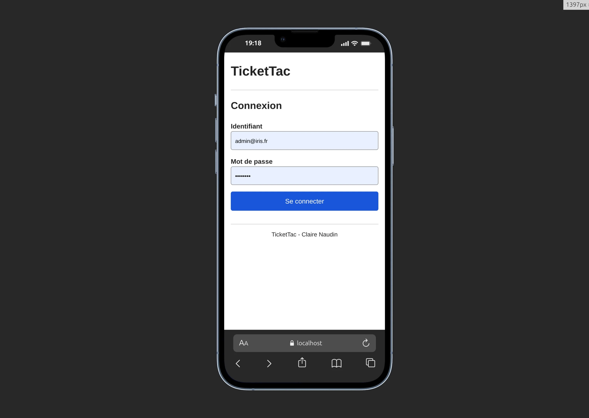
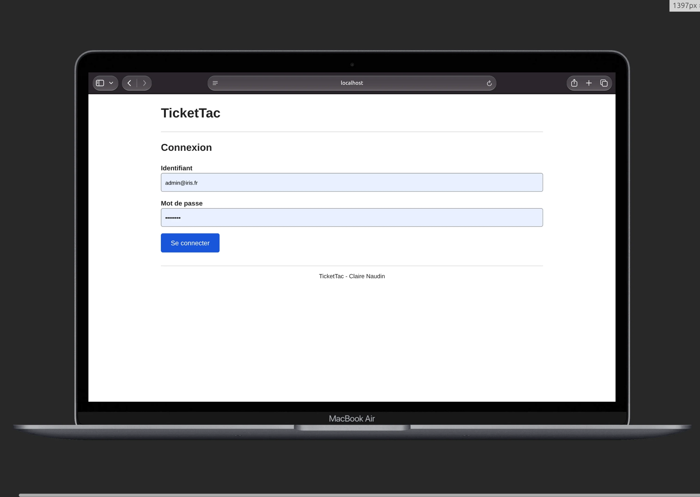
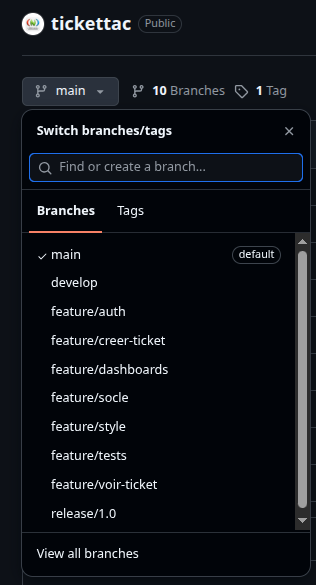
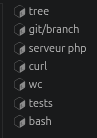

# TicketTac

Gestion de tickets d'assistance en PHP natif et MySQL (PDO), sans framework. Les usagers créent des tickets, le développeur y répond.

Projet réalisé par Claire Naudin, formation CDA 2026-2027 (Live Campus), le 20 novembre 2026.

## Aperçu

| Mobile (iPhone 13 Pro)                                                 | Ordinateur (MacBook Air)                                                 |
| ---------------------------------------------------------------------- | ------------------------------------------------------------------------ |
|  |  |

Le site est pensé mobile d'abord : formulaires pleine largeur sur petit écran, tableau défilant dans son cadre.

## Stack

- PHP 8.3 natif, sans framework, sans Composer ni npm
- MySQL 8 via PDO (requêtes préparées, identifiants dans `.env`)
- HTML avec la syntaxe alternative (`foreach: ... endforeach;`)
- CSS natif, responsive, découpé en fichiers importés par `main-css.css`
- Serveur de développement intégré de PHP, avec un routeur (`public/routeur.php`)
- Git et GitHub (GitFlow : `main`, `develop`, branches `feature/*`, `release/1.0`)

## Prérequis

- PHP 8.3
- MySQL 8

## Installation

1. Créer la base `lc_tickets` et importer le script `docs/script_sql/lc_tickets.sql`.
2. Copier `.env.example` en `.env` et renseigner `DB_HOST`, `DB_NAME`, `DB_USER`, `DB_PASS`.
3. Lancer depuis la racine du projet :

   php -S localhost:8000 -t public public/routeur.php

4. Ouvrir http://localhost:8000

## Comptes de test

| Identifiant | Rôle   | Mot de passe |
| ----------- | ------ | ------------ |
| alice       | dev    | alice        |
| bob         | usager | bob          |
| charles     | usager | charles      |

## Fonctionnalités

- Connexion, déconnexion, accès selon le rôle (403 si le rôle ne convient pas).
- Usager : créer un ticket, voir ses tickets (et seulement les siens), répondre, clôturer.
- Dev : voir les tickets en cours, répondre.
- Pages d'erreur 403, 404 et 500 avec les bons codes HTTP.
- Statuts : NOUVEAU, RESOLU, NONRESOLU, CLOS.

| Acteur | Statut du ticket     | Action possible             |
| ------ | -------------------- | --------------------------- |
| Usager | tous sauf CLOS       | Clôturer                    |
| Usager | RESOLU               | Répondre (statut NONRESOLU) |
| Dev    | NOUVEAU ou NONRESOLU | Répondre (statut RESOLU)    |
| Dev    | RESOLU ou CLOS       | Aucune action               |

Les actions sont vérifiées côté serveur, pas seulement masquées dans l'interface.

## Arborescence

```
tickettac/
├── inc/           base() et fichiers main (imports seulement)
├── public/        pages, routeur.php, css/
├── src/           fonctions : auth, tickets, messages, pages, base de données
├── vues/          pages HTML
│   └── composants/  fragments (entête, pied, tableau, détail, message)
├── tests/         tests automatisés
├── docs/          documentation, script SQL, captures
├── .env.example   modèle de configuration
└── README.md
```

Règles de conception : 100 lignes maximum par fichier, noms en minuscules, chemins construits avec `base()`, trois fichiers main qui ne font que des imports.

## Tests

php tests/tickets.php

Vérifie `validerticket()` et `actionspossibles()` (12 cas, sans base de données).

## Workflow Git

Le projet suit GitFlow : une branche par étape (`feature/socle`, `auth`, `dashboards`, `creer-ticket`, `voir-ticket`, `style`, `tests`), fusion dans `develop` avec `--no-ff`, puis `release/1.0`, fusion dans `main` et tag `v1.0`. Les commits sont courts et en anglais.





## Limites connues

- Les messages affichent « Compte 1 / Compte 2 » au lieu d'un nom.
- La 404 du routeur n'affiche pas l'utilisateur connecté.
- Pas de protection CSRF.
- Sur mobile (320 px), le tableau défile horizontalement dans son cadre ; léger décalage de marge de la navigation.
- Tests limités à `validerticket()` et `actionspossibles()` : rien sur la base, l'authentification ou les pages.
- Le dossier `docs/` est ignoré par git, sauf `docs/script_sql/` et `docs/screenshots/`.
- Le commit `77b6051` n'a pas d'espace après `fix:` (historique conservé).

## Améliorations possibles

- Afficher le nom de l'auteur sur chaque message (jointure avec la table des comptes).
- Ajouter une protection CSRF (jeton dans les formulaires).
- Ajouter un test par fichier source (authentification, messages, pages) et des tests sur une base dédiée.
- Pagination et filtre par statut sur les dashboards.
- Afficher l'utilisateur connecté sur la page 404 du routeur.
- Découper `afficherPage` et les fonctions de `src/tickets.php` en fichiers plus petits si le projet grossit.
- Passer à des classes avec espaces de noms et chargement automatique (Composer), comme conseillé en cours.
- Automatiser les tests avec GitHub Actions.

## Ce que j'ai appris

- **Architecture** : séparer `public/` (points d'entrée), `src/` (logique), `vues/` (HTML) et `tests/`, avec des fichiers `main-*` qui ne font que des imports.
- **`base()`** : centraliser les chemins pour éviter `__DIR__` partout.
- **`afficherPage` et `afficherErreur`** : une seule fonction gère le gabarit, le try/catch (500) et les codes 2xx ; les 4xx et 5xx passent par `afficherErreur`.
- **Vues en HTML** : `foreach: ... endforeach;` et composants rangés dans `vues/composants/`, séparés des pages.
- **Nommage** : minuscules partout, majuscule réservée aux classes.
- **PDO** : requêtes préparées, identifiants dans `.env`, une fonction `executerRequete` unique.
- **Sécurité** : `htmlspecialchars` en sortie, rôle contrôlé sur chaque page, statuts et actions revérifiés côté serveur (un POST forcé est refusé), un usager ne lit que ses tickets.
- **Validation** : faite une seule fois, dans une fonction réutilisable et testable.
- **Tests** : tester des fonctions pures sans base de données, avec une petite fonction `verifier`.
- **CSS responsive** : mobile d'abord, découpage en fichiers, badges de statut.
- **Git et GitHub** : GitFlow, branches `feature/*`, fusions `--no-ff`, tag, `.gitignore` avec exceptions, vérification de l'historique avec `git log` avant de relancer une commande.
- **Gestion du temps** : découper en étapes courtes, valider chaque étape, protéger le rendu avant les tests.

## Remerciements

Merci à Renaud Berthier ([@renaudberthier](https://github.com/renaudberthier)), notre enseignant, pour ses relectures et ses conseils précis : `base()` pour les chemins, `afficherPage` qui gère les erreurs, les vues écrites en HTML, les composants séparés des pages, le nommage des fichiers, et le routeur du serveur PHP. Ils ont directement façonné la structure de ce projet.
